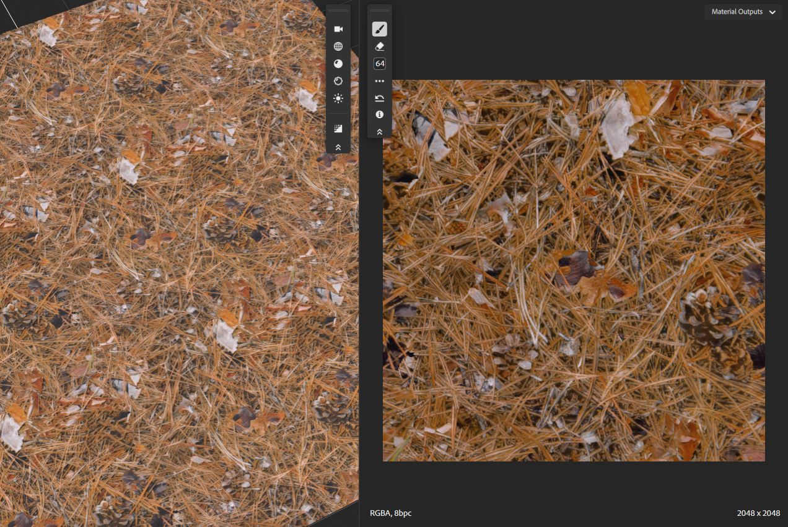

# Riempimento in base al contenuto

<table>
  <tr>
    <td> <strong>In:</strong> Strumenti</td>
    <td>Descrizione Il riempimento in base al contenuto consente di rimuovere senza problemi elementi come dirt, testo o altri oggetti indesiderati dai materiali. Nell'esempio seguente sul pavimento della foresta, il bastone si distingue nel motivo ripetuto. Con Riempimento in base al contenuto, possiamo rimuovere il rametto, rendendo la ripetizione un po' meno evidente.    <em>Prima della rimozione</em>   <em>Dopo la rimozione</em></td>
  </tr>
</table>

## Parametri

* **Selezione canali:** selezionare i canali su cui eseguire il filtro. Per impostazione predefinita, questa opzione è impostata su tutti i canali; tuttavia, potete anche scegliere di eseguire solo sui canali del Height o del Colore di base.
* **Speculare:** Per i materiali o i pattern simmetrici, questa impostazione guida Riempimento in base al contenuto per incorporare il contenuto di mirroring nel materiale.
* **Scala:** Per motivi geometrici quali porzioni o mattoni, questa impostazione consente di mantenere inalterata la struttura del motivo.

### Parametri tecnici

* **Maschera personalizzata:** applicate una maschera utilizzando una texture o usate il pennello per pittura la vostra maschera nel **riquadro di visualizzazione 2D**.
* **Cerca fattore di ritaglio:** Ritaglia l&#39;area campione utilizzata dal filtro. Per impostazione predefinita, l’area campione copre l’intera texture eccetto l’area mascherata. Aumentando il **fattore di ritaglio ricerca**, l’area campione viene ridotta in modo da limitare i campioni ai pixel più vicini all’area mascherata.

### Impostazioni di riempimento

* **Adattamento colore:** regolate il grado di adattamento del riempimento ai colori circostanti. Questa impostazione può essere utile con materiali che
* **Adattamento rotazione:** per i pattern in cui la rotazione degli elementi è importante, ad esempio i petali di un fiore o i raggi di una ruota, questa impostazione può contribuire a creare risultati più coerenti.