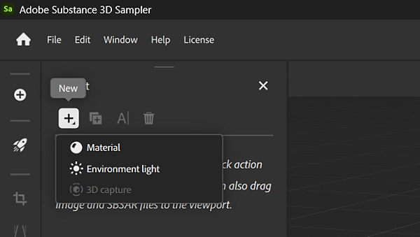

# Gestione dei progetti

In Substance 3D Sampler puoi utilizzare le raccolte per gestire tutte le risorse e i materiali. I progetti sono un buon modo per organizzare i materiali. Un progetto può essere esportato o importato per essere facilmente condiviso su più computer.

## Crea un nuovo progetto

Per creare un nuovo progetto, seleziona **Crea nuovo** nella schermata **Home** o **File > Nuovo progetto**. Quando crei un nuovo progetto, viene visualizzata la finestra di dialogo Avvio rapido, in cui puoi selezionare una [Azione rapida](../features-and-workflows/quick-actions.md) o importare un&#39;immagine o un file di Substance per avviare il progetto.

>[!TIP]
>
> Se non conoscete Sampler, [Azioni rapide](../features-and-workflows/quick-actions.md) possono aiutarvi a iniziare rapidamente imparando quello che Sampler può aiutarvi a ottenere.

In alternativa, puoi utilizzare il pulsante **Avvio rapido** per passare direttamente a un progetto vuoto. Puoi comunque importare manualmente risorse e contenuti in base alle esigenze.

Dopo aver fatto clic sul pulsante &quot;Crea nuovo&quot;, il progetto verrà aperto automaticamente e denominato &quot;*Progetto senza titolo\**&quot; fino al salvataggio del progetto. Puoi aggiungere risorse al tuo progetto con il &#x200B;** pulsante Nuova risorsa **&#x200B; evidenziato nel &#x200B;** pannello Progetto**.

{width="600px"}

## Salvare un progetto

Per salvare un progetto, utilizza l&#39;azione di menu **File > Salva** o **Salva con nome**. Viene aperta una finestra di dialogo che consente di scegliere il nome da utilizzare e la posizione in cui salvare i file di progetto.

In alternativa, puoi utilizzare la scelta rapida da tastiera **Ctrl + S** per **Salvare** o **Ctrl + Maiusc + S** per **Salvare con nome**.

I progetti salvati vengono visualizzati come file denominato **YourProject.ssa**. SSA è il formato di file dei campionatori, che memorizza le informazioni sul progetto e le eventuali dipendenze.

## Aprire un progetto esistente

I progetti possono essere aperti in alcuni modi:

* Nella **Schermata iniziale**: utilizzate l’elenco dei progetti recenti per aprire rapidamente un progetto facendo doppio clic su di esso.
* Nella **schermata iniziale**: fate clic su **Apri** per aprire un browser di file in cui scegliere il file da aprire.
* Dal menu **File > Apri progetto**.
