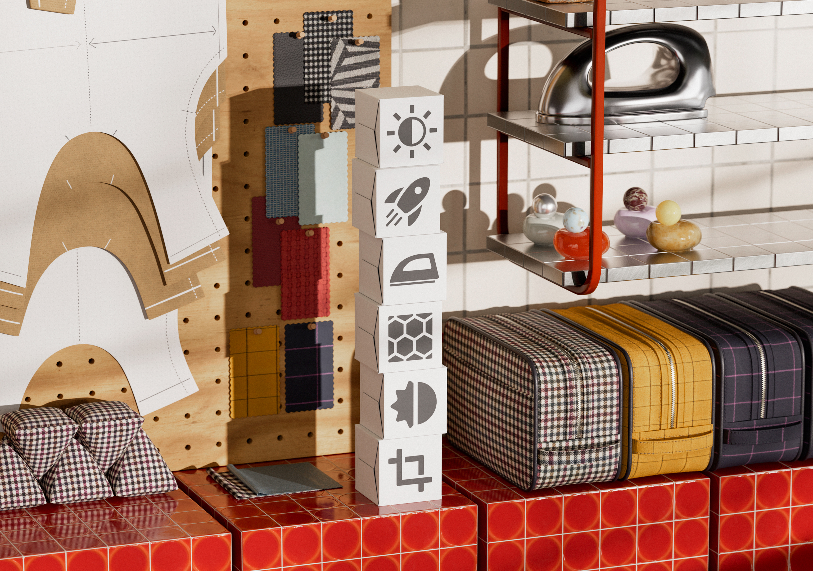

# Versione 6.1

**Kouign amann** (pasta sfoglia bretone)

Questa versione introduce la modalità Prestazioni, che consente a chiunque di disattivare le impostazioni che possono rallentare il flusso di lavoro, e miglioramenti automatici alla stabilità che proteggono gli utenti su hardware più leggero.

Le principali novità includono:

## Modalità Prestazioni

Accedi a Sampler in modo più rapido e reattivo. La nuova **modalità Prestazioni** riunisce tutte le impostazioni che possono rallentare il flusso di lavoro: limiti di risoluzione, ombre, qualità dello spostamento e tracciamento del percorso. Disattivate le funzioni non necessarie per migliorare le prestazioni e la reattività.

Ulteriori informazioni [*qui*](https://www.adobe.com/go/substance-3d-sampler-6.1-performance-mode)

## Supporto migliorato per i computer con specifiche minime

Se l&#39;hardware scende al di sotto delle [specifiche minime](../getting-started/system-requirements.md), Sampler ora esegue automaticamente le regolazioni per mantenere la stabilità. Le funzioni che con maggiore probabilità rallentano o causano un arresto anomalo vengono disattivate automaticamente.

Ulteriori informazioni [*qui*](https://www.adobe.com/go/substance-3d-sampler-6.1-low-specs-mode)

## Note sulla versione v6.1

*(Rilasciato: 19 novembre 2026)*

## Aggiunto

* &amp;lbrack;Application&amp;rbrack; Nuovo metodo di segnalazione dei requisiti hardware minimi
* &amp;lbrack;Captis&amp;rbrack; Aggiungi un&#39;opzione per scegliere tra 4 e 8 angoli di polarizzazione
* &amp;lbrack;Captis&amp;rbrack; Nuova azione rapida Captis
* &amp;lbrack;Esporta&amp;rbrack; Segnala correttamente gli errori di esportazione all&#39;utente
* &amp;lbrack;Export&amp;rbrack; Update Unreal Engine 4 export preset (rinominato Unreal Engine 5)
* &amp;lbrack;Performance&amp;brack; La creazione delle risorse dal file è ora asincrona
* &amp;lbrack;Performance&amp;rbrack; Sposta il carico di lavoro dal thread principale ai thread di lavoro
* &amp;lbrack;Prestazioni&amp;rbrack; Nuova modalità prestazioni
* &amp;lbrack;Project&amp;rbrack; Avvisa l&#39;utente se il salvataggio del progetto non è riuscito
* &amp;lbrack;Scripting&amp;rbrack; nuovo metodo generate_thumbnail per le risorse e nuova proprietà type per le risorse
* &amp;lbrack;Scripting&amp;rbrack; Rendering di un&#39;istantanea della vista 3D su file dal modulo Python
* &amp;lbrack;UI&amp;rbrack; Se si fa clic in un punto qualsiasi di un&#39;area di rilascio, viene aperta la finestra di dialogo del file
* &amp;lbrack;UI&amp;rbrack; Scelte rapide della barra di navigazione sinistra per gli strumenti (equalizza, ritaglia, Affiancamento, Trasforma, ripara, colore, ...)
* &amp;lbrack;UI&amp;rbrack; aggiorna qt-spectrum per ottenere le icone più recenti

## Fisso

* &amp;lbrack;vista 3D&amp;rbrack; Correggi Offset UV e rotazione immediati, rimuovi scala normale per OpenPBR
* &amp;lbrack;vista 3D&amp;rbrack; impedisce un arresto anomalo verificando che non si verifichi alcuna modifica dello stage durante l&#39;eliminazione della finestra della vista
* &amp;lbrack;vista 3D&amp;rbrack; rimuove correttamente le informazioni sullo spostamento (height) quando si modifica la risorsa visualizzata
* &amp;lbrack;vista 3D&amp;rbrack; Aggiorna correttamente il documento quando si elimina la trama
* &amp;lbrack;Application&amp;rbrack; verificare che la superficie rimanga attiva durante l&#39;elaborazione delle informazioni di debug del filtro dinamico
* &amp;lbrack;Application&amp;rbrack; Correggi arresto anomalo all&#39;uscita dalla scena
* &amp;lbrack;Application&amp;rbrack; Correggere il potenziale arresto anomalo quando si elimina una risorsa durante la chiusura del servizio del database delle risorse
* &amp;lbrack;Application&amp;rbrack; Rende sicuro il thread delle informazioni di debug della cache per impedire un arresto anomalo
* &amp;lbrack;Application&amp;rbrack; Impedisci l&#39;accesso a un arresto anomalo verificando che il nodo non sia null prima di accedervi
* &amp;lbrack;Application&amp;rbrack; Impedisce l&#39;arresto anomalo causato dall&#39;accesso al primo elemento di un vettore vuoto
* &amp;lbrack;Application&amp;rbrack; Impedisci arresto anomalo in invalidateVisibleIfs
* &amp;lbrack;Application&amp;rbrack; Impedisce la creazione di arresti anomali durante la chiusura del servizio di database
* &amp;lbrack;Application&amp;rbrack; Impedisce condizioni di gara all&#39;uscita
* &amp;lbrack;Assets&amp;rbrack; Assicurarsi che le risorse siano correttamente protette dietro il blocco destro
* &amp;lbrack;Captis&amp;rbrack; Bug con valore di intensità in modalità manuale
* &amp;lbrack;Captis&amp;rbrack; Impedisce all&#39;utente di selezionare una zona più grande di quella consentita dal backend
* &amp;lbrack;Impostazioni canale&amp;rbrack; doppia occorrenza di SpecularColor in ASM
* &amp;lbrack;Impostazioni canale&amp;rbrack; Correggere l&#39;ID di un utilizzo creato da una stringa
* &amp;lbrack;Content&amp;rbrack; problema di opacità Atlas scatter
* &amp;lbrack;Content&amp;rbrack; nel filtro Ricamo manca la caratteristica metallica
* &amp;blocco;Contenuto&amp;rbrack; Correggi filtro perforazione
* &amp;lbrack;Content&amp;rbrack; Correggi categoria del filtro Stilizzazione e alcune correzioni nel pannello delle risorse
* &amp;blocco;Content&amp;rbrack; Aggiorna filtro Riempimento
* &amp;lbrack;Creative Cloud&amp;rbrack; correggi il percorso delle risorse 3D in Creative Cloud
* &amp;lbrack;Engine&amp;rbrack; Impedisce l&#39;arresto anomalo durante l&#39;accesso ai dati del motore mentre il processo è stato annullato
* &amp;lbrack;Esporta&amp;rbrack; Aggiungi codice difensivo per controllare che la struttura non sia Null
* &amp;lbrack;Export&amp;rbrack; Codice difensivo per evitare arresti anomali nella generazione dell&#39;SBS
* &amp;lbrack;Esporta&amp;rbrack; Abilita l&#39;output di usi personalizzati, anche se noti al motore
* &amp;lbrack;Esporta&amp;rbrack; Correggi predefiniti di esportazione
* &amp;lbrack;Esporta&amp;rbrack; Mappa normale esportata come non elaborata in USD
* &amp;lbrack;Esporta&amp;rbrack; Usa etichette di output invece di usi quando si esporta con un predefinito
* &amp;lbrack;Exposed Parameters&amp;rbrack; Correggere i parametri esposti nei filtri dinamici
* &amp;lbrack;Exposed Parameters&amp;rbrack; corregge l&#39;aggiornamento del parametro esposto quando cambia nome
* &amp;lbrack;Filters&amp;rbrack; Verifica che i filtri dinamici e gli identificatori di modifiche siano identici tra ogni esecuzione su ogni piattaforma
* &amp;lbrack;Filters&amp;rbrack; Nascondi usi non supportati nella selezione della mappa di suddivisione automatica
* &amp;lbrack;Livelli&amp;rbrack; la modifica della visibilità dei livelli ricrea sempre le strutture
* &amp;lbrack;Layers&amp;rbrack; Arresto anomalo quando si appiattisce un timbro Clona /Clone sopra qualcosa
* &amp;lbrack;Layers&amp;rbrack; L&#39;inserimento di un generatore direttamente sulla pila ora imposta correttamente le modifiche e il nome del nodo
* &amp;lbrack;Layers&amp;rbrack; se si inserisce un generatore con Riempimento, la texture nel selettore viene visualizzata correttamente
* &amp;lbrack;Localization&amp;rbrack; Correggere la conformità del set di caratteri cinese a GB18030
* &amp;lbrack;Progetto&amp;rbrack; Arresto anomalo durante il salvataggio dopo aver colorato su un timbro Clona /Clone
* &amp;blocca;Project&amp;brack; verifica che i nomi della sessione e del progetto siano stati effettivamente salvati
* &amp;lbrack;Project&amp;rbrack; Impedisci arresto anomalo durante il salvataggio di una struttura
* &amp;lbrack;Project&amp;rbrack; è tornato il ripristino di un progetto danneggiato dal database
* &amp;lbrack;Azioni rapide&amp;rbrack; Visualizza il popup di selezione dell&#39;immagine quando non è presente alcuna immagine nella pila
* &amp;lbrack;Azioni rapide&amp;rbrack; Risolvi i problemi delle azioni rapide; l&#39;annullamento di un&#39;azione rapida non chiude più il comando Avvio rapido
* &amp;lbrack;Azioni rapide&amp;rbrack; Importa texture chiede di abilitare alcuni canali e non deve
* &amp;lbrack;Azioni rapide&amp;rbrack; Impedisce il caricamento di un arresto anomalo se un&#39;azione rapida non riesce
* &amp;lbrack;Azioni rapide&amp;rbrack; Aggiorna contenuto azioni rapide
* &amp;lbrack;Rendering&amp;rbrack; Correggere combineNormalAndHeight per i materiali ASM
* &amp;lbrack;Rendering&amp;rbrack; Correggere gli usi della texture visualizzabile con Vulkan
* &amp;lbrack;Rendering&amp;rbrack; Contrassegna struttura danneggiata quando viene modificato l&#39;output di utilizzo univoco
* &amp;lbrack;Rendering&amp;rbrack; Utilizzare la struttura di riferimento corretta per calcolare i nodi della struttura ad albero da calcolare
* &amp;lbrack;Scripting&amp;rbrack; Non bloccarsi se si verifica un errore durante un’esportazione
* &amp;lbrack;Scripting&amp;rbrack; Assicurarsi che import_images() restituisca il livello importato
* &amp;lbrack;Scripting&amp;rbrack; L&#39;impostazione di un&#39;ottimizzazione immagine per un riferimento a una risorsa immagine non riesce
* &amp;lbrack;Scripting&amp;rbrack; get_filters() non restituisce filtri dinamici
* &amp;lbrack;Thumbnail&amp;rbrack; Correggi potenziali arresti anomali durante la generazione della miniatura
* &amp;lbrack;Thumbnail&amp;rbrack; Ricrea il generatore di miniature quando cambia il layout
* &amp;lbrack;UI&amp;rbrack; se si modifica la risorsa, è possibile impostare la scala del height sul valore massimo del cursore
* &amp;lbrack;UI&amp;rbrack; Il disegno in una texture aggiorna il selettore di texture in tempo reale
* &amp;lbrack;UI&amp;rbrack; l&#39;accesso alla modalità a schermo intero senza ingrandimento riempie ora l&#39;intera finestra
* &amp;lbrack;UI&amp;rbrack; Correggi collegamento interrotto a Substance rivista
* &amp;lbrack;UI&amp;rbrack; Correggere i margini popup di esportazione
* &amp;lbrack;UI&amp;rbrack; Correggi dimensione titolo sezione
* &amp;lbrack;UI&amp;rbrack; Correggi il refuso in una stringa
* &amp;lbrack;UI&amp;rbrack; la finestra di dialogo del file Linux ora utilizza il plug-in GTK
* &amp;lbrack;UI&amp;rbrack; Impedisce l&#39;arresto anomalo durante la visualizzazione di un emoji
* &amp;lbrack;UI&amp;rbrack; Rinomina i file .ssa come &#39;archivio Adobe Substance 3D Sampler&#39; (senza versione o beta)
* &amp;lbrack;UI&amp;rbrack; Ripristina la decelerazione dello sfarfallio quando si utilizza il mouse
* &amp;lbrack;UI&amp;rbrack; piccole correzioni nella finestra di dialogo &quot;Crea nuovo materiale&quot;
